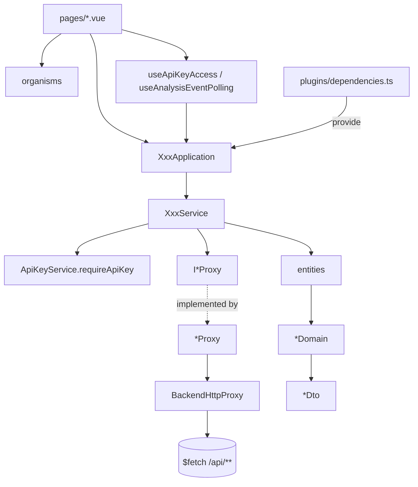

# 網頁操作台 — Architecture Design

**Status:** Confirmed
**Source PRD:** `.sdd/2026-10-17-web-console/PRD.md`
**Tech context:** Nuxt 3（`app/` 目錄、`ssr: false` SPA）· TypeScript strict · SCSS token · Vitest + `@vue/test-utils` · Bun · Clean / Onion（`.claude/rules/`）

---

## 1. Design Goal & Guiding Principle

- **In one sentence:** 把後端 9 個端點包成 6 組用例（API key、新聞搜尋、標的分析、追蹤標的評等、評等回測、服務連線狀態），讓 `.vue` 元件只拿到「已經算好畫面要用的值」的 DTO（中文標籤、語氣、格式化後的價格與百分比、輪詢與否）。
- **Guiding principle:** **後端契約只住在 proxy，業務呈現規則只住在 Domain Model。** 後端改欄位只改 proxy；新增一種評等 / 市場類別 / 回測結果只改對應 Domain Model 的對照；新增一個後端功能就是「新 proxy + 新 service + 新 application + 新 page」純新增，不動既有檔案。所有錯誤在 `BackendHttpProxy` 一處轉成兩種具名錯誤，元件只認這兩種。

---

## 2. Change Scope

| Area | Action | What / Why |
| :--- | :--- | :--- |
| 專案骨架（`package.json`、`nuxt.config.ts`、`tsconfig`、`vitest.config.ts`、ESLint、stylelint） | **Add** | 目前只有文件；依 README 的選型 scaffold |
| `app/assets/styles/` | **Add** | token 中央層（abstracts / base / main.scss），參考 Mobbin 的淺色中性儀表板風格 |
| `app/domain/` | **Add** | entities、domains、dto、vo、errors、interface、service |
| `app/infrastructure/proxy/` | **Add** | 後端 REST 與瀏覽器儲存的 proxy |
| `app/application/` | **Add** | 6 個 Application + injection keys |
| `app/components/`、`app/layouts/`、`app/pages/` | **Add** | 原子化元件與 7 個頁面 |
| `app/plugins/dependencies.ts` | **Add** | 組裝根：建立所有 proxy / service / application 並 `provide` |
| 後端 `go-symbol-news-hunter` | **Not touched** | 跨來源問題用 Nuxt 同源代理（`/api/**` → 後端）解決，不改後端加 CORS |
| SSR / 伺服器端渲染 | **Not touched** | API key 只存在瀏覽器，SSR 拿不到也沒有好處；整站 SPA |
| 狀態管理套件（Pinia） | **Not touched** | 跨頁共用狀態只有「API key 存取狀態」一個，用 `useState` composable 即可 |

---

## 3. New Classes / Modules

### 3.1 Domain — errors（`app/domain/errors/`）

| Name | Kind | Responsibility | Satisfies |
| :--- | :--- | :--- | :--- |
| `BackendRejectionError` | Error | 後端明確拒絕（帶後端 `code` 與中文 `message`）；`isApiKeyProblem` 判斷是否為 API key 缺少 / 無效 / 未啟用 | US-01 無效 API key、US-02 名稱過長、US-04 找不到此標的、US-05 上限、US-09 超過 500 筆… |
| `BackendUnavailableError` | Error | 後端連不上或回覆非預期（訊息固定「服務暫時無法使用」） | US-10 服務無法連線 |
| `InvalidInputError` | Error | 送出前就能擋的輸入錯誤（訊息即畫面提示） | US-02 名稱空白、US-04 標的空白、US-08 只填標的、US-09 期間顛倒 |

### 3.2 Domain — entities（`app/domain/models/entities/`，只有欄位）

`ApiKeyStatus`、`IssuedApiKey`、`News`、`SymbolNews`、`KeyEvent`、`AnalysisEvidence`、`PriceAtAnalysis`（`price: Decimal`）、`AnalysisResult`、`AnalysisEvent`、`StartedSymbolAnalysis`（`isNew` + `analysisEvent`）、`SessionGrade`、`TrackedSymbolGrade`、`HitRate`、`AnalysisBacktest`（價格欄位 `Decimal | undefined`）、`GradeBacktest`、`RecentAnalysis`。

每個 entity 帶 `toDomain()`（需要行為者）或 `toDto()`（純形狀轉換者）。

### 3.3 Domain — Domain Models（`app/domain/models/domains/`，行為所在地）

| Name | Responsibility | Satisfies |
| :--- | :--- | :--- |
| `GradeDomain` | 正規化評等（非法 → `neutral`）、中文標籤、語氣（`positive`/`negative`/`neutral`） | US-06 看多正向語氣、US-08、US-09 |
| `MarketCategoryDomain` | 市場類別中文標籤；列出可選類別 | US-04、US-05、US-08、US-09 |
| `TradingSessionDomain` | 交易時段中文標籤與固定順序（盤前 → 盤中 → 盤後） | US-08 各時段 |
| `TimeHorizonDomain` | 時間範圍標籤「短期（兩週內）」/「中期（三個月內）」 | US-06 |
| `BacktestOutcomeDomain` | 回測結果標籤與語氣 | US-09 尚未到期 |
| `TimestampDomain` | 時間顯示文字（台北時間 `YYYY-MM-DD HH:mm` 或只有日期） | US-06 價格時間、US-08 更新時間 |
| `ApiKeyAccessDomain` | 由「有沒有 API key」+「後端狀態或錯誤」決定存取狀態 `missing`/`inactive`/`invalid`/`active`/`unavailable`；遮蔽 API key | US-01 全部、US-03 |
| `AnalysisEventDomain` | 分析事件呈現：狀態標籤、失敗原因、`keepPolling(now)`（分析中且開始未滿 15 分鐘）、`pollingExpired(now)`；組出結果 DTO（含價格 `Decimal.toString()` 不失真、「未取得」） | US-05 自動更新 / 失敗 / 等候上限、US-06 全部 |
| `TrackedSymbolGradeDomain` | 綜合評等呈現 + 三個時段槽位（沒有的時段標「尚未產生」） | US-08 |
| `GradeBacktestDomain` | 命中率文字（`hitRate` 為 null → 「沒有資料」，否則百分比）、各分組、筆數、明細（缺價格 → 「—」、漲跌幅百分比） | US-09 |
| `RecentAnalysisListDomain` | 加入一筆：同分析事件去重移到最前、上限 20 | US-07 |
| `SymbolQueryDomain` | 驗證「標的 + 市場類別」查詢：標的必填（新聞、分析）或「一起給或都不給」（追蹤評等、回測） | US-04 標的空白、US-08 只填標的 |
| `BacktestPeriodDomain` | 驗證期間：起日不可晚於迄日 | US-09 期間顛倒 |
| `ApiKeyNameDomain` | 名稱去空白、必填 | US-02 名稱空白 |

### 3.4 Domain — DTO / VO

- 輸入 DTO：`SymbolQueryDto`（symbol, category）、`GradeBacktestQueryDto`（completedFrom, completedTo, symbol, category）、`IssueApiKeyDto`（name）。
- 輸出 DTO：`ApiKeyAccessDto`、`IssuedApiKeyDto`、`SymbolNewsDto` / `NewsDto`、`AnalysisEventDto` / `AnalysisResultDto` / `KeyEventDto` / `EvidenceDto` / `PriceAtAnalysisDto`、`StartedSymbolAnalysisDto`、`RecentAnalysisDto`、`TrackedSymbolGradeDto` / `SessionGradeDto`、`GradeBacktestDto` / `HitRateDto` / `AnalysisBacktestDto`、`LabelledValueDto`（value + label + tone，供下拉選單與 badge）、`BackendHealthDto`。
- VO：`AnalysisEventIdVo` 不需要（數字即可）；不另立 VO。

### 3.5 Domain — interfaces（`app/domain/interface/`）

| Interface | Methods | Implementation |
| :--- | :--- | :--- |
| `IApiKeyProxy` | `issueApiKey(name)`、`getApiKeyStatus(apiKey)`、`revokeApiKey(apiKey)` | `ApiKeyProxy` |
| `IApiKeyStorageProxy` | `read()`、`save(apiKey)`、`clear()` | `LocalStorageApiKeyStorageProxy` |
| `INewsProxy` | `searchSymbolNews(query, apiKey)` | `NewsProxy` |
| `IAnalysisEventProxy` | `startSymbolAnalysis(query, apiKey)`、`getAnalysisEvent(id, apiKey)` | `AnalysisEventProxy` |
| `IRecentAnalysisStorageProxy` | `read()`、`save(recentAnalyses)` | `LocalStorageRecentAnalysisStorageProxy` |
| `ITrackedSymbolGradeProxy` | `getTrackedSymbolGrades(query, apiKey)` | `TrackedSymbolGradeProxy` |
| `IGradeBacktestProxy` | `getGradeBacktest(query, apiKey)` | `GradeBacktestProxy` |
| `IBackendHealthProxy` | `checkHealth()` | `BackendHealthProxy` |

### 3.6 Domain services（`app/domain/service/`）

| Service | Public methods | Collaborators |
| :--- | :--- | :--- |
| `ApiKeyService` | `getApiKeyAccess()`、`issueApiKey(dto)`、`useApiKey(apiKey)`、`forgetApiKey()`、`revokeApiKey()`、`requireApiKey()` | `IApiKeyProxy`、`IApiKeyStorageProxy` |
| `NewsSearchService` | `searchSymbolNews(dto)` | `INewsProxy`、`ApiKeyService` |
| `SymbolAnalysisService` | `startSymbolAnalysis(dto)`（同時記住）、`getAnalysisEvent(id)`、`getRecentAnalyses()` | `IAnalysisEventProxy`、`IRecentAnalysisStorageProxy`、`ApiKeyService` |
| `TrackedSymbolGradeService` | `getTrackedSymbolGrades(dto)` | `ITrackedSymbolGradeProxy`、`ApiKeyService` |
| `GradeBacktestService` | `getGradeBacktest(dto)` | `IGradeBacktestProxy`、`ApiKeyService` |
| `BackendHealthService` | `checkHealth()` | `IBackendHealthProxy` |

`requireApiKey()` 是唯一取用「目前使用的 API key」的入口：沒有就拋 `BackendRejectionError('api_key_missing', '需要提供 API key')`，讓「沒有 API key」與「後端說缺 API key」走同一條錯誤路徑。

### 3.7 Infrastructure（`app/infrastructure/proxy/`）

| Name | Responsibility |
| :--- | :--- |
| `BackendHttpProxy` | 唯一呼叫 `$fetch` 的地方：組 base URL（`runtimeConfig.public.backendBaseUrl`，預設 `/api`）、帶 `X-API-Key`、把後端錯誤 body `{ error: { code, message } }` 轉成 `BackendRejectionError`，連線失敗 / 非預期回覆轉成 `BackendUnavailableError`；回傳 `{ status, body }` 讓 `AnalysisEventProxy` 分辨 200 / 202 |
| `ApiKeyProxy`、`NewsProxy`、`AnalysisEventProxy`、`TrackedSymbolGradeProxy`、`GradeBacktestProxy`、`BackendHealthProxy` | 各自宣告檔內 `XxxWire` 型別，把 wire 轉成 entity（日期字串 → `Date`、金額字串 → `Decimal`、缺欄位 → `undefined`） |
| `analysis-wire.ts` | `AnalysisEventProxy` 與 `GradeBacktestProxy` 共用的關鍵事件 / 佐證 wire 轉換（`TrackedSymbolGradeProxy` 也用） |
| `LocalStorageApiKeyStorageProxy`、`LocalStorageRecentAnalysisStorageProxy` | 唯一碰 `localStorage` 的地方；讀寫失敗（隱私模式）視為「沒有」 |

### 3.8 Application（`app/application/`）

`ApiKeyApplication`、`NewsSearchApplication`、`SymbolAnalysisApplication`、`TrackedSymbolGradeApplication`、`GradeBacktestApplication`、`BackendHealthApplication`：每個只轉呼叫對應 service，回傳 DTO。`application-injection-keys.ts` 定義 6 個 `InjectionKey`。

### 3.9 Controller（`.vue`）

| Layer | Components |
| :--- | :--- |
| atoms | `AppButton`（variant `primary`/`secondary`/`ghost`/`danger`、size、`loading`、`block`）、`AppInput`、`AppSelect`、`AppBadge`（tone `positive`/`negative`/`neutral`/`info`/`warning`）、`AppSpinner`、`AppCard`、`AppAlert`（tone）、`AppDialog`、`AppEmptyState`、`AppStat`、`AppPageHeader` |
| molecules | `BackendStatusIndicator`、`SymbolQueryForm`（類別 + 標的 + 送出，`symbolRequired` prop 決定是否必填）、`GradeBadge`、`KeyEventList`、`RiskFactorList`、`NewsListItem`、`IssuedApiKeyReveal`（完整 API key 一次 + 複製） |
| organisms | `ConsoleNavigation`、`ApiKeyGate`（依存取狀態顯示 slot 或引導）、`ApiKeyPanel`（狀態、重新檢查、忘記、撤銷 + `AppDialog` 確認）、`ApiKeyIssueForm`、`ApiKeyUseForm`、`NewsResultList`、`AnalysisResultReport`、`AnalysisEventStatusPanel`、`RecentAnalysisList`、`TrackedSymbolGradeTable`（可展開時段）、`BacktestQueryForm`、`GradeBacktestSummary`、`GradeBacktestTable` |
| templates | `ConsoleLayout`（側邊導覽 slot、頂列 slot、內容 slot；手機收合） |
| layouts | `default.vue`：`ConsoleLayout` + `ConsoleNavigation` + `BackendStatusIndicator` + API key 狀態 |
| pages | `index.vue`（導向 `/analysis-events`）、`api-key.vue`、`news.vue`、`analysis-events/index.vue`、`analysis-events/[analysisEventId].vue`、`tracked-symbol-grades.vue`、`grade-backtest.vue` |
| composables | `useApiKeyAccess()`：以 `useState` 共用 `ApiKeyAccessDto`，提供 `refresh()`；`useAnalysisEventPolling(id)`：每 3 秒查詢，`keepPolling` 為 false 或元件卸載即停 |

### 3.10 UI reference（Mobbin）

- 側邊分組導覽 + 頁首（標題、說明、右側主要動作）：OpenAI Platform API keys、ElevenLabs API Keys、Exa API Keys。
- 撤銷確認對話框：OpenAI Platform「Revoke secret key」。
- 統計卡 + 明細表：Gumloop Score Dashboard、Dub Events。
- 新聞清單（來源 + 時間 → 標題 → 摘要）：Binance Square News、Substack search。
- 分析報告（主內容 + 右側狀態欄）：Elicit research report。
- 視覺：淺色中性背景、白色卡片、1px 邊框、小字灰色欄位標題、膠囊狀狀態 badge、單一深色主要按鈕。

---

## 4. Modified Components

無（全新專案）。

---

## 5. Component Relationships

---

## 6. Extensibility & Handoff Notes

- **Most likely next requirement:** 後端新增功能（例：列出追蹤標的、時段執行紀錄、分析歷史清單），或新增市場類別 / 評等值。
- **Where it lands:**
  - 新後端功能 → 新 `I{能力}Proxy` + 實作 + `XxxService` + `XxxApplication` + injection key + page；`BackendHttpProxy` 已處理鑑權與錯誤，新 proxy 只寫 wire 轉換。
  - 新列舉值 → `GradeDomain` / `MarketCategoryDomain` / `TradingSessionDomain` / `BacktestOutcomeDomain` 的對照表加一列；元件只吃 DTO 的 `label` / `tone`，不用改。
  - 新錯誤碼 → 不用改：畫面顯示後端 `message`；只有需要特殊導引時才在 `BackendRejectionError` 加判斷。
- **Patterns applied & why:** Proxy + DIP（後端契約可替換）、Domain Model 封裝呈現規則（避免元件三元運算）、單一 HTTP 出口（鑑權與錯誤只有一份）。
- **Do not hardcode:** 後端位址（`NUXT_PUBLIC_BACKEND_BASE_URL` / `NUXT_BACKEND_ORIGIN`）、輪詢間隔與上限（`AnalysisEventDomain` 常數）、最近分析上限 20（`RecentAnalysisListDomain` 常數）。
- **Known debt / deferred:** 最近分析只存在瀏覽器；後端若提供分析清單 API，`RecentAnalysisListDomain` 與其 storage proxy 可整組移除改接新 proxy。

---

## 7. Traceability

| PRD Scenario | Fulfilled by |
| :--- | :--- |
| US-01 已啟用的 API key 可以使用受保護功能 | `ApiKeyService.getApiKeyAccess` + `ApiKeyAccessDomain` + `ApiKeyGate` |
| US-01 沒有 API key 時引導到設定 | `ApiKeyAccessDomain`（missing）+ `ApiKeyGate` |
| US-01 停用中的 API key 不能發起分析 | `ApiKeyAccessDomain`（inactive）+ `ApiKeyGate`「重新檢查」 |
| US-01 無效的 API key 引導重新設定 | `ApiKeyAccessDomain`（invalid）+ `BackendRejectionError.isApiKeyProblem` + `ApiKeyGate` |
| US-01 重新檢查後立即可用 | `useApiKeyAccess().refresh` + `ApiKeyService.getApiKeyAccess` |
| US-02 申請成功只顯示一次完整 API key | `ApiKeyService.issueApiKey`（並保存）+ `IssuedApiKeyReveal` |
| US-02 名稱空白不送出 | `ApiKeyNameDomain` → `InvalidInputError` |
| US-02 名稱過長顯示服務給的原因 | `BackendHttpProxy` → `BackendRejectionError.message` + `ApiKeyIssueForm` |
| US-02 離開後不再顯示完整 API key | `IssuedApiKeyReveal` 只存在元件狀態；`ApiKeyPanel` 顯示 `ApiKeyAccessDomain` 遮蔽值 |
| US-03 貼上既有 API key | `ApiKeyService.useApiKey` + `ApiKeyUseForm` |
| US-03 貼上無效的 API key | `ApiKeyService.useApiKey`（驗證失敗不保存） |
| US-03 在這個瀏覽器忘記 API key | `ApiKeyService.forgetApiKey` + `ApiKeyPanel` |
| US-03 撤銷 API key 並確認 | `ApiKeyService.revokeApiKey`（撤銷後清除）+ `ApiKeyPanel` + `AppDialog` |
| US-03 撤銷時取消 | `ApiKeyPanel` + `AppDialog` |
| US-04 搜尋成功 | `NewsSearchService` + `NewsProxy` + `NewsResultList` |
| US-04 部分新聞來源失敗 | `SymbolNewsDto.failedNewsProviders` + `NewsResultList` |
| US-04 近 7 天沒有新聞 | `NewsResultList` 空狀態 |
| US-04 標的不存在 | `BackendRejectionError` + `news.vue` |
| US-04 所有新聞來源失敗 | `BackendRejectionError` + `news.vue` |
| US-04 標的空白不送出 | `SymbolQueryDomain` → `InvalidInputError` |
| US-05 新分析自動更新到完成 | `SymbolAnalysisService.startSymbolAnalysis` + `useAnalysisEventPolling` + `AnalysisEventDomain.keepPolling` |
| US-05 重用已完成的分析 | `StartedSymbolAnalysis` + `AnalysisEventDomain`（succeeded 不輪詢） |
| US-05 重用正在進行的分析 | `AnalysisEventDomain.keepPolling` |
| US-05 分析失敗 | `AnalysisEventDomain`（failed + 原因）+ `AnalysisEventStatusPanel` |
| US-05 分析數量已達上限 | `BackendRejectionError` + `analysis-events/index.vue` |
| US-05 分析事件不存在 | `BackendRejectionError` + `analysis-events/[analysisEventId].vue` |
| US-05 離開頁面停止自動更新 | `useAnalysisEventPolling`（`onScopeDispose`） |
| US-05 等候超過上限 | `AnalysisEventDomain.pollingExpired` + `AnalysisEventStatusPanel` |
| US-06 完整呈現分析結果 | `AnalysisEventDomain` + `GradeDomain` + `TimeHorizonDomain` + `AnalysisResultReport` |
| US-06 分析時價格 | `AnalysisEventDomain`（`PriceAtAnalysisDto`）+ `TimestampDomain` |
| US-06 極小價格不失真 | `AnalysisEventProxy`（字串 → `Decimal`）+ `Decimal.toString()` |
| US-06 價格未取得 | `AnalysisEventDomain`（「未取得」） |
| US-07 列出發起過的分析 | `SymbolAnalysisService.getRecentAnalyses` + `RecentAnalysisList` |
| US-07 最多 20 筆 | `RecentAnalysisListDomain` |
| US-07 同一分析事件只列一次 | `RecentAnalysisListDomain` |
| US-08 列出追蹤標的的綜合評等 | `TrackedSymbolGradeService` + `TrackedSymbolGradeDomain` + `TrackedSymbolGradeTable` |
| US-08 展開查看各時段評等 | `TrackedSymbolGradeDomain`（三時段槽位）+ `TrackedSymbolGradeTable` |
| US-08 指定單一標的 | `SymbolQueryDomain` + `TrackedSymbolGradeProxy` |
| US-08 只填標的不送出 | `SymbolQueryDomain` → `InvalidInputError` |
| US-08 沒有資料 | `TrackedSymbolGradeTable` 空狀態 |
| US-09 整體命中率並列隨機基準 | `GradeBacktestDomain` + `GradeBacktestSummary` |
| US-09 分組沒有資料 | `GradeBacktestDomain`（null → 「沒有資料」） |
| US-09 尚未到期的明細 | `GradeBacktestDomain` + `BacktestOutcomeDomain` + `GradeBacktestTable` |
| US-09 期間顛倒不送出 | `BacktestPeriodDomain` → `InvalidInputError` |
| US-09 超過 500 筆 | `BackendRejectionError` + `grade-backtest.vue` |
| US-09 價格服務無法連線 | `BackendRejectionError` + `grade-backtest.vue` |
| US-09 從明細回到分析 | `GradeBacktestTable`（連到 `/analysis-events/:id`） |
| US-10 服務連線正常 | `BackendHealthService` + `BackendStatusIndicator` |
| US-10 服務無法連線 | `BackendHttpProxy` → `BackendUnavailableError` + 各頁 `AppAlert` 重試 + `BackendStatusIndicator` |

---

## 8. Implementation Notes (deviations found while building)

- **Added Domain Models:** `SymbolNewsDomain`（新聞新到舊排序、失敗來源文字）、`RatioDomain`（命中率、漲跌幅百分比文字）、`ConfidenceBandDomain`（信心分組標籤）、`BackendHealthDomain`（服務連線狀態標籤）。原設計把這些行為寫在別的元件或沒列出，實作時依「行為放 Domain Model、禁 module-level 計算函式」拆出。
- **Added service:** `MarketCategoryService.listMarketCategories()`，四個需要市場類別下拉選單的 Application 共用。
- **Added DTOs:** `SessionSlotDto`、`OutcomeCountDto`；`ApiKeyAccessDto` 帶 `isUsable` / `canRecheck` / `needsSettings` / `hasApiKey`，讓元件不必判斷狀態。
- **Injection keys** 放在 `app/composables/application-injection-keys.ts`（不在 `app/application/`），因為它需要 `vue` 的 `InjectionKey` 型別，而 Application 層不得 import Vue。
- **API key 存取狀態** 不是 module singleton，而是由組裝根 `provide` 的 `ApiKeyAccessState`（每個 Vue app 一份），`useApiKeyAccess()` 透過 inject 共用。
- **`BackendHttpProxy`** 以 `ignoreResponseError` 讀取錯誤回覆，網路失敗統一轉成 `BackendUnavailableError`。
- **`TrackedSymbolGradeCard`** 從 `TrackedSymbolGradeTable` 拆出，每張卡片自己管理展開狀態。
- **`ConsolePageLayout`**（template）讓每個頁面只有單一根節點。

---

## 9. Risks & Open Decisions

- **Risks / trade-offs:**
  - 後端沒有 CORS；正式部署必須讓操作台與後端同源（同一個 reverse proxy 或 Nuxt node server 的 `routeRules` 代理）。只靜態部署無代理時無法運作。
  - `shopspring/decimal` 預設輸出字串；若後端改成數字輸出，`BackendHttpProxy` 之後的 proxy 需改為從原始文字解析才不失真——目前以字串為準。
  - 台北時間顯示用 `Intl.DateTimeFormat`（`Asia/Taipei`），不依賴瀏覽器時區。
- **Open decisions (for implementation):** 無。
