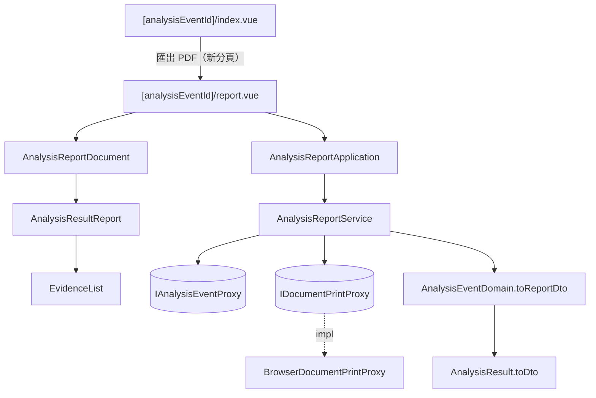

# 分析結果匯出 PDF — Architecture Design

**Status:** Confirmed
**Source PRD:** `.sdd/2026-10-28-analysis-result-pdf-export/PRD.md`
**Tech context:** Nuxt 3（`ssr: false` SPA）· TypeScript strict · SCSS token · Vitest + `@vue/test-utils` · Clean / Onion（`.claude/rules/`）

---

## 1. Design Goal & Guiding Principle

- **In one sentence:** 新增一個「分析報告」頁 `/analysis-events/:analysisEventId/report`，以紙本版面呈現已完成分析的結果，載入完成後透過瀏覽器的列印／存檔視窗存成 PDF；預設檔名、匯出時間、投資聲明與「可不可以匯出」都由 Domain 算好放進 `AnalysisReportDto`。
- **Guiding principle:** **分析結果只有一種畫法，紙本只是它的另一個版面。** 報告本體直接重用分析事件頁的 `AnalysisResultReport`（再包上頁首、頁尾），結果 DTO 的組裝收斂到 `AnalysisResult.toDto()` 一處——畫面與 PDF 不可能漂移。「列印」這個瀏覽器副作用藏在 `IDocumentPrintProxy` 後面，元件與 domain 不碰 `window.print` / `document.title`。

**為何不在瀏覽器內直接產生 PDF 檔：** 報告以繁體中文為主，jsPDF / pdfmake 需嵌入數 MB 的 CJK 字型；html2canvas 類方案把畫面轉圖，文字不可選、連結失效。列印引擎產出的是向量文字、連結可點，且字型由系統提供。

---

## 2. Change Scope

| Area | Action | What / Why |
| :--- | :--- | :--- |
| `app/domain/models/entities/analysis-result.ts` | **Modify** | 新增 `toDto()`，把原本寫在 `AnalysisEventDomain` 內的結果 DTO 組裝搬回來源（Feature Envy），讓分析事件與分析報告共用 |
| `app/domain/models/domains/analysis-event-domain.ts` | **Modify** | `toDto` 改用 `result.toDto()`，並帶出 `isReportExportable`；新增 `toReportDto(exportedAt)` |
| `app/domain/models/dto/analysis-event-dto.ts` | **Modify** | 新增 `isReportExportable: boolean` |
| `app/pages/analysis-events/[analysisEventId].vue` | **Move + Modify** | 搬到 `[analysisEventId]/index.vue`（否則 Nuxt 會把 `report.vue` 當成它的巢狀子路由）；頁首動作區加「匯出 PDF」 |
| `app/components/organisms/AnalysisResultReport.vue` | **Modify** | 佐證清單改用新的 `EvidenceList`；新增 `showEvidenceLink` 讓報告印出完整網址 |
| `KeyEventList.vue`、`RiskFactorList.vue`、`AppCard.vue`、`AppStat.vue` | **Modify（只改樣式）** | 加上 `break-inside: avoid`／列印時去陰影，滿足「不切頁」與紙本外觀 |
| `app/assets/styles/` | **Modify** | 新增 `print-hidden` mixin 與 `base/_print.scss`（`@page` A4、頁邊距 token） |
| `app/plugins/dependencies.ts`、`application-injection-keys.ts` | **Modify** | 組裝與 provide `AnalysisReportApplication` |
| `tests/setup.ts` | **Modify** | stub `definePageMeta`（Nuxt 編譯期 macro，Vitest 下不存在） |
| 新增的 domain / application / proxy / page / layout / 元件 | **Add** | 見 §3 |
| `SymbolAnalysisService` / `SymbolAnalysisApplication` | **Not touched** | 匯出是新用例，另開 service / application，不擴大既有類別的依賴 |
| `IAnalysisEventProxy` / 後端 | **Not touched** | 報告用的資料就是既有的分析事件，不需要新端點 |
| PDF 產生套件 | **Not touched** | 見 §1 理由；不新增 runtime dependency |
| 分析事件頁的自動更新 | **Not touched** | 報告頁只查一次，不輪詢 |

---

## 3. New Classes / Modules

| Name | Kind | Responsibility (purpose) | Collaborators | Satisfies (PRD scenario) |
| :--- | :--- | :--- | :--- | :--- |
| `AnalysisReportDto` | DTO（`dto/`） | 報告頁需要的一切：`analysisEventId`、`symbol`、`category`、`completedAtText`、`exportedAtText`、`fileName`、`disclaimer`、`result: AnalysisResultDto` | — | US-03、US-04 全部 |
| `AnalysisEventDomain.toReportDto(exportedAt)` | Domain Model method | 不可匯出就丟 `AnalysisReportUnavailableError`；否則組出檔名「{市場類別}-{標的}-分析-{完成日期(台北)}」、匯出時間、投資聲明 | `TimestampDomain`、`MarketCategoryDomain`、`AnalysisResult.toDto()` | US-02 尚無結果、US-03 全部、US-04 頁首／頁尾 |
| `AnalysisReportUnavailableError` | 哨兵錯誤（`errors/`） | 訊息固定「這筆分析尚無可匯出的結果」；頁面據以顯示並不開啟存檔視窗 | — | US-02 直接打開尚無分析結果的分析報告 |
| `IDocumentPrintProxy` | 介面（`interface/`） | `printDocument(documentTitle: string): void`——以指定標題（＝預設檔名）開啟列印／存檔視窗 | — | US-02、US-03 |
| `BrowserDocumentPrintProxy` | Proxy（`infrastructure/proxy/`） | 暫時把 `document.title` 換成檔名、呼叫 `window.print()`，在 `afterprint` 還原標題 | `window`、`document` | US-02、US-03 |
| `AnalysisReportService` | Domain Service | `getAnalysisReport(analysisEventId)`：取分析事件 → `toDomain().toReportDto(new Date())`；`printAnalysisReport(analysisReportDto)`：以 `fileName` 開啟存檔視窗 | `IAnalysisEventProxy`、`IDocumentPrintProxy`、`ApiKeyService` | US-02、US-03、US-04 |
| `AnalysisReportApplication` | Application | 轉呼叫上述兩個用例 | `AnalysisReportService` | US-02 |
| `pages/analysis-events/[analysisEventId]/report.vue` | Page（Controller） | `layout: 'report'`；`ApiKeyGate` 內載入報告；成功且渲染後（`nextTick`）自動列印**一次**；工具列「匯出 PDF」再次列印、「返回分析事件」 | `AnalysisReportApplication`、`useRequest` | US-02 全部 |
| `layouts/report.vue` | Layout | 只有紙張寬度的置中容器，沒有側欄與頂列 | — | US-05 不含操作元件 |
| `AnalysisReportDocument.vue` | Organism | 紙本本體：頁首（標的分析報告、市場類別、標的、分析事件 #、完成時間）＋ `AnalysisResultReport`（`showEvidenceLink`）＋ 頁尾（匯出時間、投資聲明） | `AnalysisResultReport` | US-04、US-05 |
| `EvidenceList.vue` | Molecule | 佐證新聞清單（標題連結、來源・時間）；`showLink` 時於標題下印完整網址；每則 `break-inside: avoid` | — | US-04 分析佐證附完整網址、US-05 不切頁 |
| `print-hidden` mixin + `base/_print.scss` | 樣式 | `@media print { display: none }`；`@page { size: A4 portrait; margin }`、列印時背景色保留（`print-color-adjust: exact`）| — | US-05 |

> 報告頁的「載入 → 渲染 → 列印」由頁面依序呼叫兩個 application method。這是 UI 時序（必須等 DOM 畫好才能列印），不是業務流程拆散給呼叫端排，因此不合併成一個方法。

---

## 4. Modified Components

| Component | Current role | Change needed |
| :--- | :--- | :--- |
| `AnalysisResult`（entity） | 只有欄位 | 新增 `toDto(): AnalysisResultDto`（含價格「未取得」處理），內容自 `AnalysisEventDomain` 原封搬入 |
| `AnalysisEventDomain` | 組 `AnalysisEventDto` | `isReportExportable = status === 'succeeded' && result !== undefined`（`toDto` 與 `toReportDto` 共用，留成 private getter）；新增 `toReportDto` |
| `AnalysisEventDto` | 分析事件畫面資料 | 加 `isReportExportable` |
| `[analysisEventId]/index.vue` | 分析事件頁 | `v-if="analysisEvent?.isReportExportable"` 時顯示 `NuxtLink` 「匯出 PDF」（`target="_blank"`）指向報告頁；自動更新到已完成時隨之出現 |
| `AnalysisResultReport` | 分析結果四張卡片 | 佐證改用 `EvidenceList`；新 prop `showEvidenceLink?: boolean` |
| `AppCard` / `AppStat` | 卡片 / 數值 | 列印時去陰影；`AppCard` 標題 `break-after: avoid` |
| `KeyEventList` / `RiskFactorList` | 清單 | 項目 `break-inside: avoid` |

---

## 5. Component Relationships

---

## 6. Extensibility & Handoff Notes

- **Most likely next requirement:** 其他畫面也要匯出（追蹤標的評等、評等回測），或想改成「不經存檔視窗、直接下載」。
- **Where it lands:**
  - 新的匯出對象：`report` layout、`print-hidden` mixin、`_print.scss`、`IDocumentPrintProxy` 全部可直接重用；新增「`XxxDomain.toReportDto` + 報告頁 + 紙本 organism」即可，純新增。
  - 直接下載：換掉 `IDocumentPrintProxy` 的實作（例如改成把報告 DOM 交給 PDF 產生器的 proxy），報告頁與 domain 不動；介面可能需要多帶報告根節點，屆時再擴充。
- **Patterns applied & why:** Proxy 隔離瀏覽器副作用（可在測試以 `vi.fn()` 替換）；DTO 帶出已算好的檔名與可匯出旗標，元件不寫業務判斷。
- **Do not hardcode:** 檔名格式、投資聲明、可匯出條件只在 `AnalysisEventDomain`；頁邊距等列印數值只在 token。
- **Known debt / deferred:** 各瀏覽器存檔視窗預設目的地與瀏覽器自帶頁首頁尾不可控（PRD §7 已列為已知風險）。

---

## 7. Traceability

| PRD Scenario | Fulfilled by |
| :--- | :--- |
| US-01 已完成的分析顯示匯出動作 | `AnalysisEventDomain`（`isReportExportable`）+ `[analysisEventId]/index.vue` |
| US-01 分析中不顯示匯出動作 | `AnalysisEventDomain`（`isReportExportable=false`）+ 分析事件頁 |
| US-01 分析失敗不顯示匯出動作 | `AnalysisEventDomain`（`isReportExportable=false`）+ 分析事件頁 |
| US-01 分析完成時匯出動作隨即出現 | 既有 `useAnalysisEventPolling` 更新 DTO → 分析事件頁 reactive 顯示 |
| US-02 匯出開啟分析報告並開啟存檔視窗 | 分析事件頁 `NuxtLink target=_blank` + `report.vue` 載入後 `printAnalysisReport` |
| US-02 取消存檔視窗後可以再次匯出 | `report.vue` 工具列（「匯出 PDF」、「返回分析事件」） |
| US-02 直接打開分析報告的網址 | `report.vue`（獨立路由）+ `AnalysisReportService.getAnalysisReport` |
| US-02 直接打開尚無分析結果的分析報告 | `AnalysisEventDomain.toReportDto` 丟 `AnalysisReportUnavailableError` + `report.vue` 不列印 |
| US-02 沒有可用的 API key 時打開分析報告 | 既有 `ApiKeyGate` + `ApiKeyService.requireApiKey`；`report.vue` 只在成功時列印 |
| US-02 服務無法回覆時打開分析報告 | 既有 `BackendUnavailableError` + `RequestErrorAlert`（重試）；`report.vue` 不列印 |
| US-03 台股的預設檔名 | `AnalysisEventDomain.toReportDto`（`fileName`）+ `BrowserDocumentPrintProxy` |
| US-03 美股的預設檔名 | 同上 |
| US-03 分析完成日期以台灣時間計 | `TimestampDomain.toDateText()`（Asia/Taipei） |
| US-04 報告頁首 | `AnalysisReportDto` + `AnalysisReportDocument` |
| US-04 分析結論 | `AnalysisResult.toDto()` + `AnalysisResultReport` |
| US-04 分析時價格未取得 | `AnalysisResult.toDto()`（「未取得」） |
| US-04 逐條列出關鍵事件與風險因子 | `AnalysisResultReport` + `KeyEventList` / `RiskFactorList` |
| US-04 沒有關鍵事件 | `AnalysisResultReport`（空狀態） |
| US-04 沒有風險因子 | `AnalysisResultReport`（空狀態） |
| US-04 分析佐證附完整網址 | `EvidenceList`（`showLink`） |
| US-04 報告頁尾 | `AnalysisReportDto.exportedAtText` / `disclaimer` + `AnalysisReportDocument` |
| US-05 黑白列印仍可辨識評等 | `GradeBadge` 永遠帶中文標籤 |
| US-05 內容超過一頁時延續到下一頁 | `break-inside: avoid`（`EvidenceList`、`KeyEventList`）、`break-after: avoid`（區塊標題） |
| US-05 PDF 不含操作元件 | `layouts/report.vue` + `print-hidden`（工具列）+ `@page` A4 |

---

## 8. Risks & Open Decisions

- **Risks / trade-offs:**
  - 列印分頁行為（`break-inside`）各瀏覽器支援度略有差異；Chrome / Edge / Firefox / Safari 新版皆支援，可接受。
  - 自動開啟列印視窗會阻塞該分頁；報告在新分頁開啟，不影響原本的分析事件頁。
  - 搬移 `[analysisEventId].vue` 會連帶搬移其測試與 `console-router` fixture 的 import。
- **Open decisions (for implementation):** 無。
