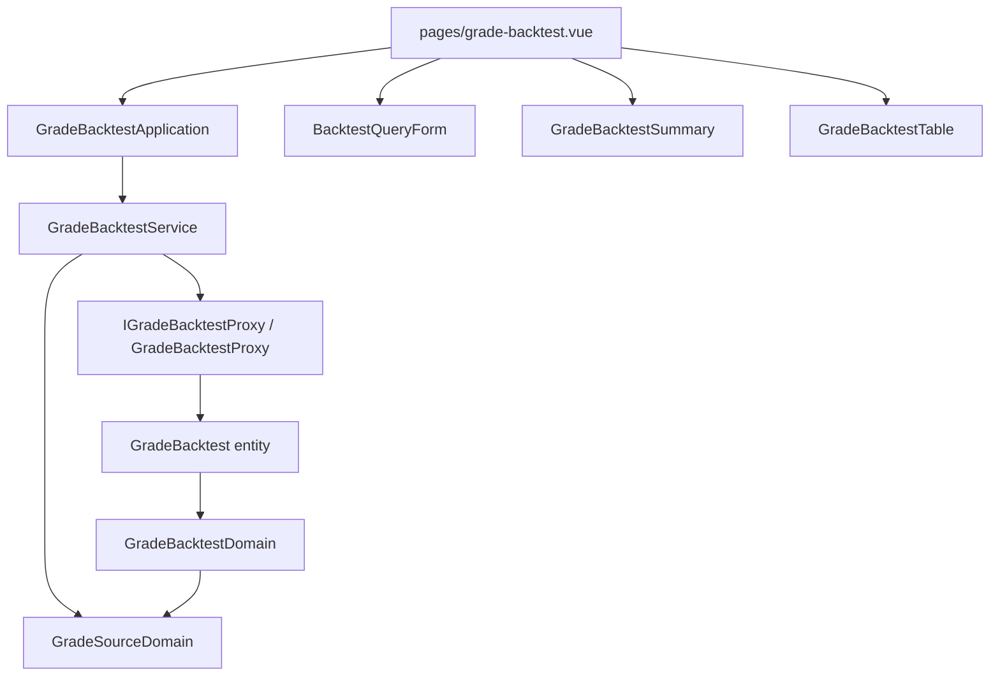

# 評等回測依來源比較 — Architecture Design

**Status:** Confirmed
**Source PRD:** `.sdd/2026-10-28-grade-source/PRD.md`
**Tech context:** Nuxt 3 · TypeScript · Clean / Onion（Proxy → entity → Domain Model → DTO → Application → 元件）

---

## 1. Design Goal & Guiding Principle

- **In one sentence:** 把後端新增的評等來源（查詢參數 `source`、總表 `bySource`、明細 `gradeRecordId` / `source` / `tradingDay`、可為 null 的 `analysisEventId`）一路接到評等回測頁：表單多一個來源下拉、總表多一張依來源表、明細多來源與交易日欄，只有手動紀錄的標的可點。
- **Guiding principle:** **評等來源的值域與顯示文字只住在 `GradeSourceDomain`。** 表單選項、依來源表、明細欄都從它取 `LabelledValueDto`；之後新增來源只改這一個檔案。「這一列能不能連到分析事件」由 Domain Model 決定（有沒有 `analysisEventId`），元件只看 DTO 有沒有值。

---

## 2. Change Scope

| Area | Action | What / Why |
| :--- | :--- | :--- |
| `domain/models/domains/grade-source-domain.ts` | **Add** | `GRADE_SOURCES = ['manual', 'background']`、標籤「手動」「背景」、`toDto()`；不認得的值照原值顯示 |
| `GradeBacktestProxy`（wire 型別、查詢參數） | **Modify** | 送出 `source`；讀 `bySource`、`gradeRecordId`、`source`、`tradingDay`；`analysisEventId` 可為 null |
| `entities/analysis-backtest.ts`、`entities/grade-backtest.ts` | **Modify** | 新欄位：`gradeRecordId`、`source`、`analysisEventId?`、`tradingDay?`；`bySource` |
| `GradeBacktestDomain.toDto` | **Modify** | 多 `bySource`（依 `GRADE_SOURCES` 順序、缺的組為「沒有資料」）；明細 DTO 帶 `gradeRecordId`、`source`、`analysisEventId?`、`tradingDayText` |
| `dto/analysis-backtest-dto.ts`、`dto/grade-backtest-dto.ts`、`dto/grade-backtest-query-dto.ts` | **Modify** | 新欄位 |
| `vo/grade-backtest-query-vo.ts` | **Modify** | `source: string \| undefined`（空字串＝不限） |
| `GradeBacktestService` | **Modify** | 把查詢的來源放進 VO；新增 `listGradeSources()` |
| `GradeBacktestApplication` | **Modify** | 轉呼叫 `listGradeSources()` |
| `BacktestQueryForm.vue` | **Modify** | 新 prop `sources`、「評等來源」下拉（placeholder「全部」） |
| `GradeBacktestSummary.vue` | **Modify** | 多「依來源」卡片 |
| `GradeBacktestTable.vue` | **Modify** | 來源欄、交易日欄、只有手動紀錄的標的是連結、`:key` 改 `gradeRecordId`、用語改「評等紀錄」「建立時間」 |
| `pages/grade-backtest.vue` | **Modify** | 傳 `sources`；頁面說明改「評等紀錄」 |
| README 後端 API 表 | **Modify** | `/grade-backtest` 加 `source` |
| 追蹤標的評等、分析事件、分析報告 | **Not touched** | 服務回傳不變 |

---

## 3. New Classes / Modules

| Name | Kind | Responsibility (purpose) | Collaborators | Satisfies (PRD scenario) |
| :--- | :--- | :--- | :--- | :--- |
| `GradeSourceDomain` | Domain Model | 評等來源的值域、標籤，`toDto()` → `LabelledValueDto`（不認得的值 label = 原值） | — | US-02 依來源顯示命中率、US-03 服務回傳不認得的來源 |

---

## 4. Modified Components

| Component | Current role | Change needed |
| :--- | :--- | :--- |
| `GradeBacktestService.getGradeBacktest` | 驗證期間、標的，呼叫 proxy | 來源字串 trim 後，空字串 → `undefined`，放進 `GradeBacktestQueryVo` |
| `GradeBacktestDomain.toDto` | 組命中率總表與明細 DTO | 依來源分組；明細來源 / 交易日 / 可選分析事件編號 |
| `GradeBacktestTable.vue` | 明細表 | 依 `analysis.analysisEventId` 是否有值決定 `NuxtLink` 或純文字 |

---

## 5. Component Relationships

---

## 6. Extensibility & Handoff Notes

- **Most likely next requirement:** 新增一種評等來源（例如時段評等），或從背景紀錄連到追蹤標的評等頁。
- **Where it lands:** 新來源 → `GRADE_SOURCES` 與標籤各加一筆，表單、總表、明細自動跟上。連結 → `GradeBacktestDomain` 為背景紀錄多產一個連結目標欄位，表格依它決定連結。
- **Do not hardcode:** 元件內不得寫死 `'manual'` / `'background'` 判斷；一律看 DTO。
- **Known debt / deferred:** 無。

---

## 7. Traceability

| PRD Scenario | Fulfilled by |
| :--- | :--- |
| US-01 只看背景評等紀錄 | `BacktestQueryForm` → `GradeBacktestService`（VO `source`）→ `GradeBacktestProxy`（查詢參數） |
| US-01 只看手動評等紀錄 | 同上 |
| US-01 預設不限來源 | `GradeBacktestService`（空字串 → 不送） |
| US-02 依來源顯示命中率 | `GradeBacktestDomain.toDto`（`bySource`）+ `GradeBacktestSummary` |
| US-02 背景沒有可評估的紀錄 | `GradeBacktestDomain.toDto`（`hitRate` 為空 →「沒有資料」） |
| US-02 服務沒有提供依來源的命中率 | `GradeBacktestProxy`（缺欄位 → 空 Map）+ `GradeBacktestDomain`（缺組 →「沒有資料」） |
| US-03 手動評等紀錄可點開分析事件 | `GradeBacktestDomain`（`analysisEventId`）+ `GradeBacktestTable`（`NuxtLink`） |
| US-03 背景評等紀錄顯示交易日、不能點 | `GradeBacktestDomain`（`tradingDayText`、無 `analysisEventId`）+ `GradeBacktestTable` |
| US-03 手動評等紀錄沒有交易日 | `GradeBacktestDomain`（`tradingDayText` =「—」） |
| US-03 服務回傳不認得的來源 | `GradeSourceDomain.toDto` |

---

## 8. Risks & Open Decisions

- **Risks / trade-offs:** 後端未更新時，`gradeRecordId` 不存在，明細列的 key 會重複；兩個專案同一天合併，可接受。
- **Open decisions (for implementation):** 無。
