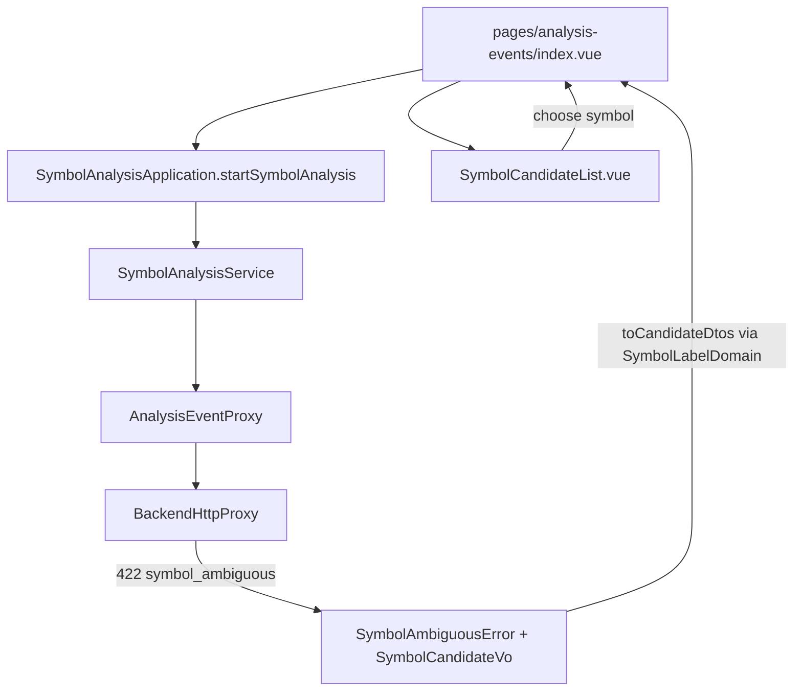

# 操作台以名稱發起分析 — Architecture Design

**Status:** Confirmed
**Source PRD:** `.sdd/2026-10-28-symbol-name-input/PRD.md`
**Tech context:** Nuxt 3 · TypeScript · Clean / Onion（`.vue` = Controller）· Vitest

---

## 1. Design Goal & Guiding Principle

- **In one sentence:** 後端回覆 `422 symbol_ambiguous` 並附 `candidates` 時，`BackendHttpProxy` 丟出帶候選的具名錯誤 `SymbolAmbiguousError`（`BackendRejectionError` 的子類別）。標的分析頁據此在錯誤說明下方列出候選；點選候選就以「候選代號 + 原市場類別」再呼叫一次既有的發起分析。標的欄提示改由頁面傳入。
- **Guiding principle:** 「符合多個標的」只是一種帶資料的服務拒絕，沿用既有的「Proxy 包成具名錯誤 → 元件以 `instanceof` 分流」，不新增 Application 方法。候選的顯示文字沿用 `SymbolLabelDomain`，與全操作台一致。

---

## 2. Change Scope

| Area | Action | What / Why |
| :--- | :--- | :--- |
| `domain/errors/symbol-ambiguous-error.ts` | **Add** | `SymbolAmbiguousError extends BackendRejectionError`，持有 `SymbolCandidateVo[]`；`toCandidateDtos()` 以 `SymbolLabelDomain` 產生 `SymbolCandidateDto` |
| `domain/models/vo/symbol-candidate-vo.ts` | **Add** | 候選（`symbol`、`symbolName`） |
| `domain/models/dto/symbol-candidate-dto.ts` | **Add** | 給元件的形狀（`symbol`、`symbolLabel`） |
| `infrastructure/proxy/backend-http-proxy.ts` | **Modify** | `ErrorBodyWire.error` 加 `candidates?`；code 為 `symbol_ambiguous` 時丟 `SymbolAmbiguousError`（沒有附候選則為空清單） |
| `components/molecules/SymbolCandidateList.vue` | **Add** | 候選按鈕清單；`choose(symbol)` 事件；`loading` 時停用按鈕 |
| `components/molecules/SymbolQueryForm.vue` | **Modify** | 新增 `symbolPlaceholder` prop（預設維持「例如 2330、AAPL、BTC」） |
| `pages/analysis-events/index.vue` | **Modify** | 傳入名稱提示；記住最近一次送出的市場類別；錯誤為 `SymbolAmbiguousError` 且有候選時顯示 `SymbolCandidateList`，選擇後 `run(new SymbolQueryDto(symbol, category))` |
| Application / Domain Service / `AnalysisEventProxy` | **Not touched** | 發起分析流程與我發起過的分析的記錄方式不變（本來就記服務回覆的代號與名稱） |
| 新聞搜尋、追蹤標的評等、評等回測頁 | **Not touched** | 服務在這些功能只認代號 |

---

## 3. New Classes / Modules

| Name | Kind | Responsibility (purpose) | Collaborators | Satisfies (PRD scenario) |
| :--- | :--- | :--- | :--- | :--- |
| `SymbolAmbiguousError` | Domain error | 攜帶候選，並轉成元件可用的 DTO | `SymbolCandidateVo`、`SymbolLabelDomain` | 列出候選、候選沒有名稱、服務沒有附上候選 |
| `SymbolCandidateVo` | VO | 服務回覆的一個候選 | — | 同上 |
| `SymbolCandidateDto` | DTO | 候選的代號與顯示文字 | — | 同上 |
| `SymbolCandidateList.vue` | molecule | 呈現候選並發出選擇 | `AppButton` | 點選候選發起分析 |

---

## 4. Modified Components

| Component | Current role | Change needed |
| :--- | :--- | :--- |
| `BackendHttpProxy.request` | 非 2xx 轉成 `BackendRejectionError` / `BackendUnavailableError` | `symbol_ambiguous` 改丟 `SymbolAmbiguousError(message, candidates)` |
| `SymbolQueryForm.vue` | 標的查詢表單 | `symbolPlaceholder` prop |
| `pages/analysis-events/index.vue` | 發起分析 | 名稱提示、候選清單、以候選再發起 |

---

## 5. Component Relationships

---

## 6. Extensibility & Handoff Notes

- **Most likely next requirement:** 輸入時自動完成；新聞搜尋也接受名稱。
- **Where it lands:** 自動完成需要後端新端點 → 新 Proxy 方法回 `SymbolCandidateVo[]`，可直接重用 `SymbolCandidateDto` 與 `SymbolCandidateList.vue`。新聞搜尋接受名稱時，頁面只要傳入同樣的 `symbolPlaceholder` 並重用候選清單。
- **Do not hardcode:** 提示文字由頁面傳入，表單不判斷「哪一頁可以填名稱」。
- **Known debt / deferred:** 無。

---

## 7. Traceability

| PRD Scenario | Fulfilled by |
| :--- | :--- |
| 標的分析頁提示代號與名稱 | `pages/analysis-events/index.vue` → `SymbolQueryForm.symbolPlaceholder` |
| 新聞搜尋頁維持只提示代號 | `SymbolQueryForm` 預設提示 |
| 列出候選 | `BackendHttpProxy` → `SymbolAmbiguousError.toCandidateDtos` → `SymbolCandidateList.vue` |
| 點選候選發起分析 | `SymbolCandidateList` `choose` → 頁面 `run(new SymbolQueryDto(symbol, category))` |
| 候選沒有名稱時只顯示代號 | `SymbolLabelDomain.toText` |
| 服務沒有附上候選 | `BackendHttpProxy`（空清單）+ 頁面只在有候選時顯示清單 |
| 找不到標的照舊顯示 | `BackendRejectionError`（不變）+ `RequestErrorAlert` |
| 以台股名稱發起 | 既有 `SymbolAnalysisService.startSymbolAnalysis`（記服務回覆的代號與名稱） |
| 以美股名稱發起 | 同上 |
| 美股資料來源無法使用時記下填的字 | 同上 |

---

## 8. Risks & Open Decisions

- **Risks / trade-offs:** 錯誤物件帶 DTO 轉換方法，元件需 `instanceof` 判斷；與既有 `isApiKeyProblem` 的做法一致。
- **Open decisions:** 無。
