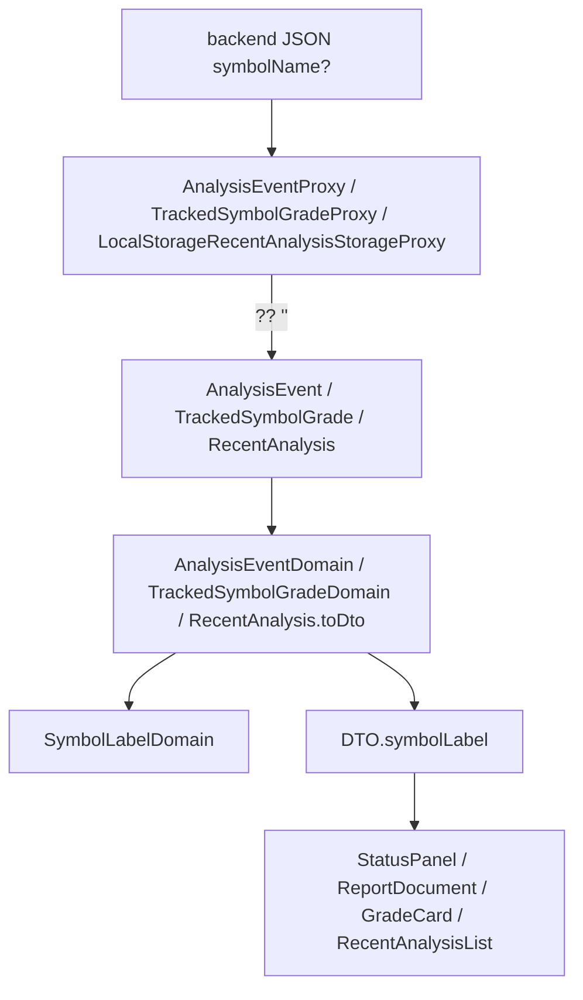

# 操作台顯示標的名稱 — Architecture Design

**Status:** Confirmed
**Source PRD:** `.sdd/2026-10-28-symbol-name/PRD.md`
**Tech context:** Nuxt 3 · TypeScript · Clean / Onion（`app/domain/models/{entities,domains,dto,vo}`）· Vitest

---

## 1. Design Goal & Guiding Principle

- **In one sentence:** proxy 把後端的 `symbolName` 收進 entity（缺值 → `''`），一個新的 `SymbolLabelDomain` 決定「代號 名稱 / 代號」與報告檔名片段，各 Domain Model 把結果放進 DTO 的 `symbolLabel`，元件只換掉綁定的欄位。
- **Guiding principle:** **標的怎麼寫只有一個地方決定——`SymbolLabelDomain`。** 元件 template 不做「有沒有名稱」的判斷（component-design：業務判斷不寫進 template 三元運算）；之後要改寫法（括號、只顯示名稱…）只改這一個 Domain Model。

---

## 2. Change Scope

| Area | Action | What / Why |
| :--- | :--- | :--- |
| `app/domain/models/domains/symbol-label-domain.ts` | **Add** | 標的顯示文字與報告檔名片段的唯一規則 |
| `entities/analysis-event.ts`、`entities/tracked-symbol-grade.ts`、`entities/recent-analysis.ts` | **Modify** | 各加 `symbolName: string`（緊接 `symbol` 之後） |
| `infrastructure/proxy/analysis-event-proxy.ts`、`tracked-symbol-grade-proxy.ts` | **Modify** | wire 加 `symbolName?: string`，轉 entity 時 `?? ''` |
| `infrastructure/proxy/local-storage-recent-analysis-storage-proxy.ts` | **Modify** | 存讀 `symbolName`；舊資料沒有 → `''` |
| `domain/service/symbol-analysis-service.ts` | **Modify** | 記下我發起過的分析時帶入 `analysisEvent.symbolName` |
| `AnalysisEventDomain`、`TrackedSymbolGradeDomain`、`RecentAnalysis.toDto` | **Modify** | 用 `SymbolLabelDomain` 產生 `symbolLabel`；`toReportDto` 的檔名改用檔名片段 |
| `dto/analysis-event-dto.ts`、`analysis-report-dto.ts`、`tracked-symbol-grade-dto.ts`、`recent-analysis-dto.ts` | **Modify** | 加 `symbolLabel: string`（保留 `symbol` 供 key 與連結） |
| `AnalysisEventStatusPanel.vue`、`AnalysisReportDocument.vue`、`TrackedSymbolGradeCard.vue`、`RecentAnalysisList.vue` | **Modify** | 顯示改綁 `symbolLabel` |
| 分析結果的 `symbolName`（後端 `result.symbolName`） | **Not touched** | 與分析事件同名，畫面只需要事件層的名稱 |
| 新聞搜尋、評等回測、樣式 / token | **Not touched** | Out of scope；版面不變 |

---

## 3. New Classes / Modules

| Name | Kind | Responsibility (purpose) | Collaborators | Satisfies (PRD scenario) |
| :--- | :--- | :--- | :--- | :--- |
| `SymbolLabelDomain` | Domain Model | 建構子收 `(symbol, symbolName)`，名稱去前後空白；`toText()` → 「代號 名稱」或「代號」（名稱原樣）；`toFileNameParts()` → `[代號, 名稱]` 或 `[代號]`，名稱去掉 `.` 與檔名不能有的字元（`\ / : * ? " < > |`），去完是空的就只留代號；兩者各自從欄位組，互不依賴 | 被 `AnalysisEventDomain`、`TrackedSymbolGradeDomain`、`RecentAnalysis` 使用 | US-01 全部、US-03 全部 |

---

## 4. Modified Components

| Component | Current role | Change needed |
| :--- | :--- | :--- |
| `AnalysisEventDomain.toDto` / `toReportDto` | 組分析事件與報告 DTO | 帶 `symbolLabel`；檔名 `[市場類別, ...toFileNameParts(), '分析', 日期].join('-')` |
| `TrackedSymbolGradeDomain.toDto` | 組追蹤標的評等 DTO | 帶 `symbolLabel` |
| `RecentAnalysis.toDto` | 組我發起過的分析 DTO | 帶 `symbolLabel` |
| `SymbolAnalysisService.startSymbolAnalysis` | 發起並記下分析 | `new RecentAnalysis(id, symbol, symbolName, category, startedAt)` |

---

## 5. Component Relationships

---

## 6. Extensibility & Handoff Notes

- **Most likely next requirement:** 新聞搜尋或評等回測也要顯示名稱（後端補上後）；或改寫法（如「台積電（2330）」）。
- **Where it lands:** 寫法 → `SymbolLabelDomain`；新畫面 → 其 entity 加 `symbolName`、Domain Model 用 `SymbolLabelDomain` 帶出 `symbolLabel`。
- **How to add it:** 不動元件邏輯，只改 Domain Model 與 DTO 欄位。
- **Do not hardcode:** 元件內不得拼接代號與名稱。
- **Known debt / deferred:** 我發起過的分析的名稱只在發起當下記下，不會隨後端更新。

---

## 7. Traceability

| PRD Scenario | Fulfilled by |
| :--- | :--- |
| US-01 台股有標的名稱 | `SymbolLabelDomain.toText` |
| US-01 美股有標的名稱 | `SymbolLabelDomain.toText` |
| US-01 標的名稱是空的 | `SymbolLabelDomain.toText` |
| US-01 標的名稱只有空白 | `SymbolLabelDomain` 建構子去空白 |
| US-01 服務沒有提供標的名稱 | proxy `symbolName ?? ''` + `SymbolLabelDomain` |
| US-02 分析事件頁的分析狀態 | `AnalysisEventDomain.toDto` → `AnalysisEventStatusPanel.vue` |
| US-02 分析報告頁首 | `AnalysisEventDomain.toReportDto` → `AnalysisReportDocument.vue` |
| US-02 追蹤標的評等卡片 | `TrackedSymbolGradeDomain.toDto` → `TrackedSymbolGradeCard.vue` |
| US-02 沒有標的名稱的追蹤標的評等卡片 | 同上 + `SymbolLabelDomain` |
| US-03 有標的名稱的報告檔名 | `AnalysisEventDomain.toReportDto` + `SymbolLabelDomain.toFileNameParts` |
| US-03 沒有標的名稱的報告檔名 | 同上 |
| US-04 新發起的分析記下標的名稱 | `SymbolAnalysisService.startSymbolAnalysis` + storage proxy + `RecentAnalysis.toDto` → `RecentAnalysisList.vue` |
| US-04 本功能上線前記下的分析 | `LocalStorageRecentAnalysisStorageProxy.read`（缺 `symbolName` → `''`） |

---

## 8. Risks & Open Decisions

- **Risks / trade-offs:** 檔名帶進名稱。美股名稱常有 `.`（「Apple Inc.」），瀏覽器可能把 `.` 之後當副檔名而截斷建議檔名，所以檔名片段會清掉 `.` 與檔名非法字元；畫面文字不受影響（code review 後修正）。
- **Open decisions:** 無。
